# 🏙️ ZelaFix API — Zeladoria Urbana Colaborativa & Gestão Municipal Inteligente

> **Advanced Business Development with .NET** — FIAP (2º Ano ADS / 2TDSPG — Global Solution 2026 - 2º Semestre)  
> 🌐 **API em Produção (Render / Swagger UI):** https://advanced-business-development-with-dot.onrender.com/  
> API RESTful corporativa de alta performance desenvolvida em **.NET 10 (Minimal APIs)** fundamentada em **Clean Architecture (DDD)**, princípios **SOLID**, **KISS**, **YAGNI**, **DRY** e **Clean Code**, persistência relacional estrita em **Oracle Database + EF Core (sem dependência de PL/SQL)**, **Paginação, Ordenação e Filtros Dinâmicos**, **Idempotência de Requisições** com cabeçalho `Idempotency-Key`, **Rate Limiting Nativo Fixed Window**, camadas completas de **Monitoramento e Observabilidade** (Health Checks com `HealthCheckResponseWriter`, Logging Estruturado Serilog com `X-Correlation-ID`, tratamento de exceções RFC 7807 Problem Details), segurança de senhas com **BCrypt**, **Autenticação e Autorização JWT Bearer (RFC 7519 / HS256)** com controle de acesso baseado em papéis (**RBAC**: `CIDADAO` / `GESTOR`) e suíte de **106 Testes Automatizados (Padrão AAA)** com xUnit, Moq e WebApplicationFactory.

---

## 🛠️ Tecnologias & Badges


---

## 👥 Integrantes

| Nome | RM | Turma | GitHub | LinkedIn |
| :--- | :---: | :---: | :--- | :--- |
| **Enzo Okuizumi** | **561432** | 2TDSPG | [EnzoOkuizumiFiap](https://github.com/EnzoOkuizumiFiap) | [Enzo Okuizumi](https://www.linkedin.com/in/enzo-okuizumi-b60292256/) |
| **Gustavo Okada** | **563428** | 2TDSPG | [Gdev3356](https://github.com/Gdev3356) | [Gustavo Okada](https://www.linkedin.com/in/gustavo-okada-53a3b8359/) |
| **Lucas Barros Gouveia** | **566422** | 2TDSPG | [LuzBGouveia](https://github.com/LuzBGouveia) | [Lucas Barros Gouveia](https://www.linkedin.com/in/lucas-barros-gouveia-09b147355/) |
| **Luna de Carvalho Guimarães** | **562290** | 2TDSPG | [lunaguima](https://github.com/lunaguima) | [Luna Guimarães](https://www.linkedin.com/in/luna-guimar%C3%A3es-b0ba82309/) |
| **Milton Marcelino** | **564836** | 2TDSPG | [MiltonMarcelino](https://github.com/MiltonMarcelino) | [Milton Marcelino](https://www.linkedin.com/in/milton-marcelino-250298142) |

---

## 💡 Sobre o Projeto & Funcionalidades

O **ZelaFix** é uma solução de **CitizenTech** alinhada ao **Objetivo de Desenvolvimento Sustentável 11 (ODS 11 — Cidades e Comunidades Sustentáveis)** da ONU. Seu propósito fundamental é transformar a zeladoria urbana municipal através da colaboração cívica em tempo real, conectando munícipes e poder público em um fluxo transparente, auditável e orientado a dados.

Cidadãos enfrentam diariamente problemas críticos na infraestrutura das cidades: buracos em vias de tráfego intenso, pontos de iluminação pública inoperantes, descarte irregular de entulho e lixo, vazamentos na rede de água ou esgoto, árvores com risco iminente de queda e sinalizações de trânsito vandalizadas. O ZelaFix elimina o atrito dos canais burocráticos tradicionais através de uma API moderna, permitindo a abertura rápida de chamados com geolocalização e evidência fotográfica, acompanhamento de status em tempo real e apoio comunitário de vizinhos.

### 🌟 Destaques Arquiteturais & Negócio
1. **Evidência Fotográfica em Imagem Relacional (Base64 / BLOB):**
   Envio seguro de fotos capturadas na câmera ou galeria mobile (JPEG, PNG, WebP de até 5 MB) trafegadas em Base64 e persistidas diretamente em colunas binárias `BLOB` (`FOTO`) do Oracle Database. Elimina despesas e complexidade de integração com buckets externos de nuvem, mantendo integridade transacional ACID estrita.
2. **Resolução Transparente de Localidade via ViaCEP (`IViaCepService`):**
   O munícipe informa apenas CEP e número da ocorrência. O serviço de aplicação consulta o ViaCEP de maneira resiliente e normaliza/reaproveita automaticamente os registros de `Bairro`, `Cidade` e `Estado` na base relacional do Oracle.
3. **Mobilização Popular & Escalonamento por Pressão Comunitária (`VOTO_CHAMADO`):**
   Moradores da mesma vizinhança podem registrar apoio a chamados já abertos (`POST /api/v1/chamados/{id}/apoiar`). A ocorrência persiste o apoio em `VOTO_CHAMADO` via EF Core, garantindo unicidade de voto por usuário e disparando a regra de domínio de escalonamento comunitário: chamados com alto engajamento sobem automaticamente de prioridade para atendimento preferencial pela subprefeitura.
4. **Trilha Histórica de Auditoria e Transparência (`HIST_CHAMADO`):**
   Toda movimentação no ciclo de vida da ocorrência gera um registro imutável contendo data/hora, status de origem, novo status, autor da alteração e parecer técnico explicativo.
5. **Garantia de Idempotência em Operações Críticas (`Idempotency-Key`):**
   Abertura de chamados (`POST /api/v1/chamados`) e transição de status operacional (`PATCH /api/v1/chamados/{id}/status`) aceitam o cabeçalho HTTP `Idempotency-Key`. Evita duplicação acidental sob conexões móveis instáveis, devolvendo a resposta original gravada em cache e o cabeçalho `Idempotent-Replayed: true`.
6. **Rate Limiting Nativo Fixed Window:**
   Proteção nativa contra abusos e ataques de negação de serviço:
   - Política Global: limite de 100 requisições por janela de 60 segundos por IP.
   - Política de Autenticação: limite estrito de 10 requisições por janela de 60 segundos para `/register` e `/login`.
7. **Autenticação Segura JWT e Controle Granular RBAC (`CIDADAO` / `GESTOR`):**
   Tokens JWT assinados com HS256 contendo claims de identidade e perfil. Endpoints de mutação operacional (tramitar status, gerenciar catálogo oficial de categorias de serviços públicos) exigem a política `GestorOnly`.
8. **Regras de Negócio e Transações Atômicas no C# (`IUnitOfWork`):**
   Todas as regras de negócio (abertura, atualização de status com histórico e votos populares) operam via EF Core gerenciadas pelo `UnitOfWork` em C#, garantindo portabilidade, facilidade de manutenção e zero acoplamento a procedures opacas de banco de dados.
9. **Arquitetura 100% Relacional (Zero NoSQL & Zero LLM):**
   Totalmente livre de dependências artificiais de MongoDB ou APIs externas de LLM. A solução foca na solidez transacional, integridade referencial e alta performance relacional exigidas em contratos de governança pública.

---

## 🏛️ Diagrama de Arquitetura

```text
┌─────────────────────────────────┐
│        App Mobile Cidadão       │
│   (React Native / Expo Mobile)  │
└────────────────┬────────────────┘
                 │ HTTPS + JWT Bearer + Idempotency-Key
                 ▼
┌───────────────────────────────────────────────────────────────────────────────┐
│                              Solução .NET 10                                  │
│                                                                               │
│  ┌─────────────────────────────────────────────────────────────────────────┐  │
│  │ ZelaFix.Api (ASP.NET Core Minimal APIs RESTful)                         │  │
│  │ Endpoints /api/v1 · JWT Bearer · Idempotência · Rate Limiting · Health  ├──┼───► [/health] ───► Orquestrador
│  └──────────────────┬───────────────────────────────────┬──────────────────┘  │
│                     │ chama                             │ DI / Configuração   │
│                     ▼                                   ▼                     │
│  ┌─────────────────────────────────────┐   ┌───────────────────────────────┐  │
│  │ ZelaFix.Application                 │◄──┤ ZelaFix.Infrastructure        │  │
│  │ Services · DTOs (Records)           │   │ EF Core (Oracle Database)     │  │
│  │ Validações · Casos de Uso           │   │ Repositórios · Configurations │  │
│  └─────────┬───────────────────┬───────┘   │ UnitOfWork                    │  │
│            │ usa               │           └────────┬──────────────────────┘  │
│            ▼                   │                    │                         │
│  ┌─────────────────────────┐   │                    │                         │
│  │ ZelaFix.Domain          │   │                    │                         │
│  │ Entidades · Invariantes │   │                    │                         │
│  │ Enums Cargo · BCrypt    │   │                    │                         │
│  └─────────────────────────┘   │                    │                         │
└────────────────────────────────┼────────────────────┼─────────────────────────┘
                                 │                    │
                  HttpClient     │       EF Core      │ Oracle EF Core Provider
                 (Consulta CEP)  │    (13 Entidades)  │ (Code-First / Mappings)
                                 ▼                    ▼
                        ┌─────────────────┐  ┌───────────────────────────┐
                        │   API ViaCEP    │  │   Oracle Database Free    │
                        │ (Serviço Ext.)  │  │ (localhost:1521/FREEPDB1) │
                        └─────────────────┘  └───────────────────────────┘
```

---

## 🗄️ Modelagem Lógica e Relacional do Banco de Dados

O banco de dados do **ZelaFix** é normalizado em 3ª Forma Normal (3FN), garantindo integridade referencial estrita, constraints de checagem semântica (`CHECK`) e índices de unicidade nos campos de negócio.

### Modelo Lógico
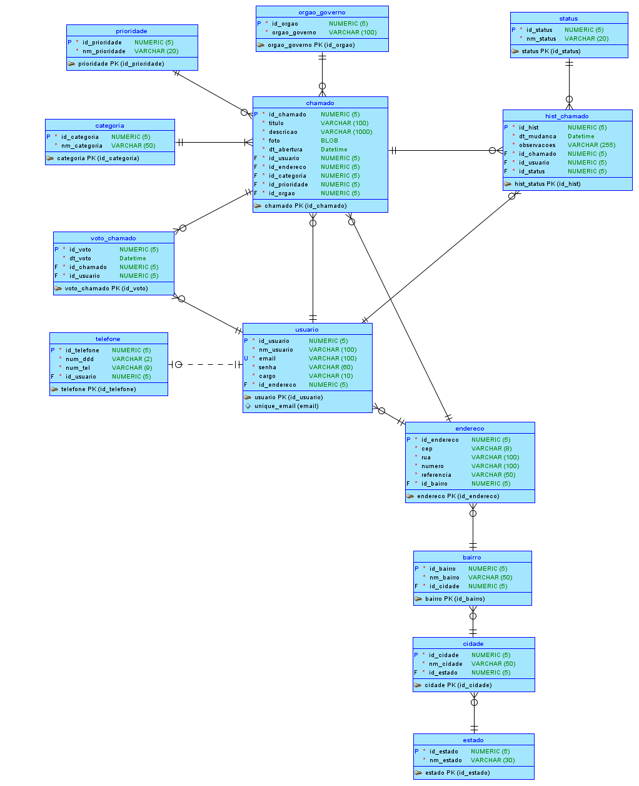

### Modelo Relacional
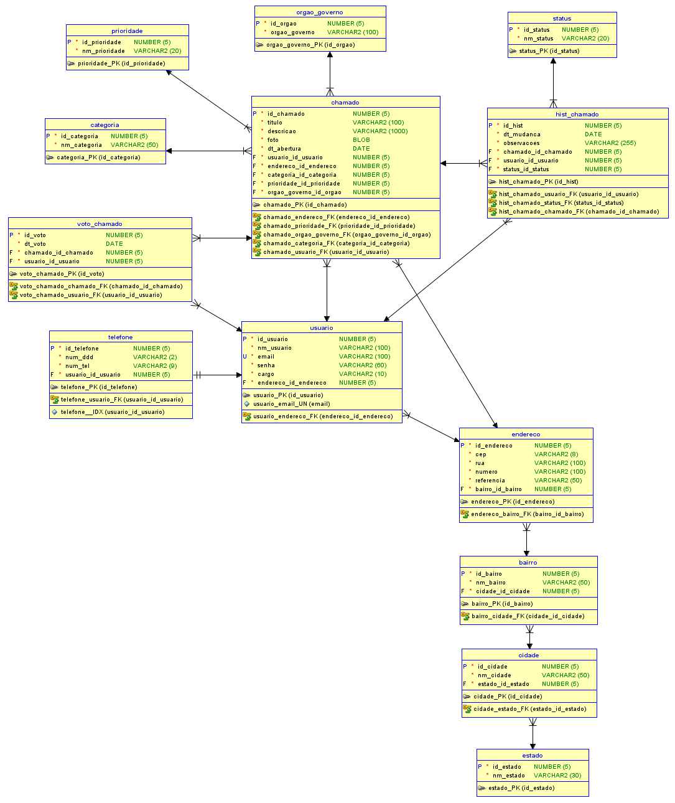

---

### 📋 Mapeamento das 13 Tabelas Relacionais de Domínio (+ `__EFMigrationsHistory` no Oracle Database)

| Tabela Oracle | Entidade C# (.NET 10) | Descrição & Propósito no Ecossistema ZelaFix |
| :--- | :--- | :--- |
| `CHAMADO` | `Chamado` | Entidade nuclear: registra o chamado urbano, título, descrição detalhada, evidência fotográfica em BLOB, data de abertura e referências externas. |
| `CATEGORIA` | `Categoria` | Catálogo oficial de tipologias de zeladoria (`ILUMINACAO_PUBLICA`, `VIAS_E_PAVIMENTACAO`, `DRENAGEM_E_ESGOTO`, `LIMPEZA_URBANA`, `ARVORES_E_PARQUES`, `SINALIZACAO_E_TRANSITO`). |
| `HIST_CHAMADO` | `HistChamado` | Linha do tempo cronológica e imutável de transição de status dos chamados com pareceres técnicos. |
| `VOTO_CHAMADO` | `VotoChamado` | Votos de apoio comunitário de cidadãos para impulsionar a prioridade da ocorrência na fila municipal (índice único `CHAMADO_ID + USUARIO_ID`). |
| `ENDERECO` | `Endereco` | Endereços cadastrados e resolvidos automaticamente com integração ao ViaCEP (`CEP`, `RUA`, `NUMERO`, `REFERENCIA`). |
| `BAIRRO` | `Bairro` | Bairros normalizados pertencentes a uma cidade específica para agregação territorial e cálculo de criticidade. |
| `CIDADE` | `Cidade` | Cidades federadas vinculadas a uma Unidade da Federação. |
| `ESTADO` | `Estado` | Unidades Federativas (UF) brasileiras com nomenclatura oficial. |
| `USUARIO` | `Usuario` (`Cargo` Enum) | Cidadãos e Gestores públicos municipais com senhas criptografadas via BCrypt e coluna `CARGO` (`CIDADAO` / `GESTOR`). |
| `TELEFONE` | `Telefone` | Contatos telefônicos associados de forma 1:1 a cada usuário (`NUM_DDD` + `NUM_TEL`). |
| `STATUS` | `Status` | Máquina de estados finita do ciclo de vida operacional: `PENDENTE`, `EM_ANALISE`, `EM_EXECUCAO`, `CONCLUIDO`, `REJEITADO`. |
| `PRIORIDADE` | `Prioridade` | Classificação de criticidade do atendimento público: `BAIXA`, `MEDIA`, `ALTA`, `URGENTE`. |
| `ORGAO_GOVERNO` | `OrgaoGoverno` | Órgãos, secretarias e concessionárias competentes (`SECRETARIA_OBRAS`, `CET_TRANSITO`, `ILUMINACAO_PUBLICA`, `DEFESA_CIVIL`, `SUBPREFEITURA`, `SANEAMENTO_BASICO`). |
| `__EFMigrationsHistory` | *(EF Core Metadata)* | Controle de versionamento de migrações aplicadas no schema Oracle (`Initial` e `AlignWithOracleModel`). |

---

### 📸 Evidências das Tabelas Populadas no Oracle Database (SQL Developer / Evidências)

Abaixo constam as capturas de tela reais do banco de dados Oracle 19c oficial da solução após migração automática (`DbInitializer`) e execução dos fluxos:

* **Visão Geral de Todas as Tabelas no Schema (`USER_TABLES`):**  
  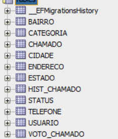

#### 1. Chamados Urbanos, Histórico de Tramitação e Votos Comunitários
* **Tabela `CHAMADO`:** Ocorrências urbanas com foto em BLOB e chaves estrangeiras:  
  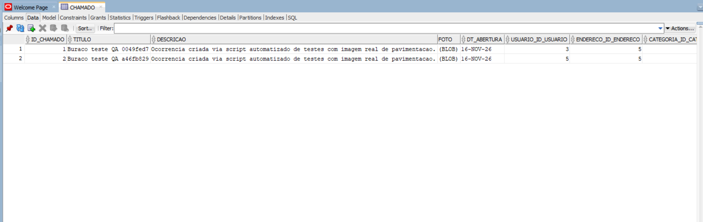
* **Tabela `HIST_CHAMADO`:** Trilha de auditoria das transições de status:  
  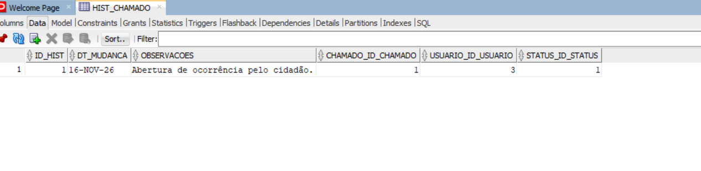
* **Tabela `VOTO_CHAMADO`:** Apoios comunitários de munícipes registrados com unicidade:  
  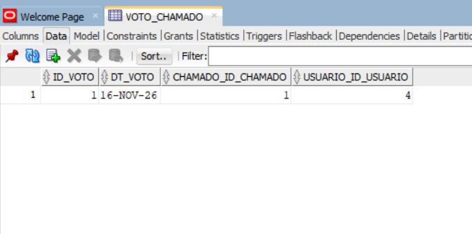

#### 2. Usuários, Contatos e Estrutura de Autenticação
* **Tabela `USUARIO`:** Cidadãos e fiscais públicos com senhas em hash BCrypt:  
  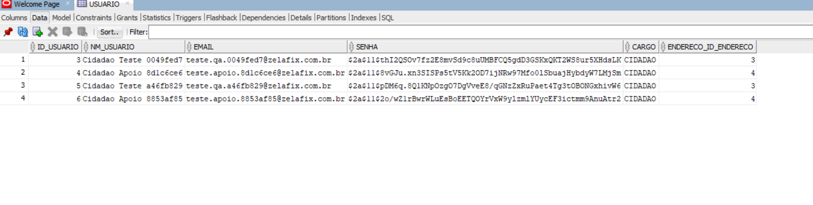
* **Tabela `TELEFONE`:** Contatos telefônicos vinculados aos usuários:  
  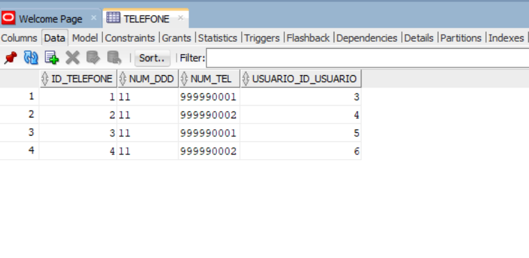

#### 3. Domínios de Catálogo, Órgãos e Parametrizações
* **Tabela `CATEGORIA`:** Tipologias oficiais de zeladoria com check constraints:  
  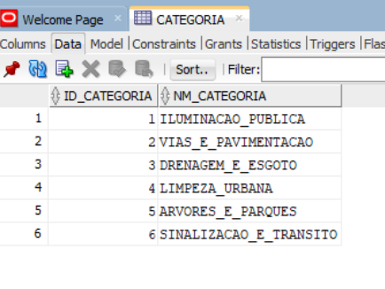
* **Tabela `STATUS`:** Estados operacionais finitos (`PENDENTE` a `CONCLUIDO`):  
  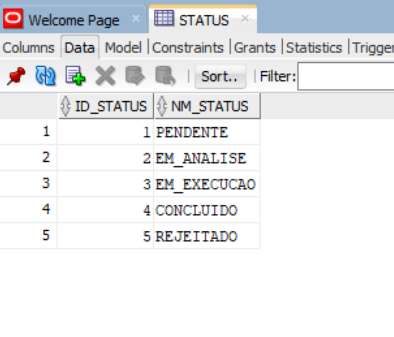
* **Tabela `PRIORIDADE`:** Níveis de urgência de atendimento municipal:  
  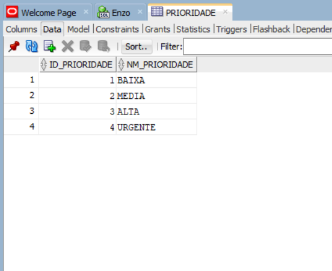
* **Tabela `ORGAO_GOVERNO`:** Secretarias e departamentos municipais cadastrados:  
  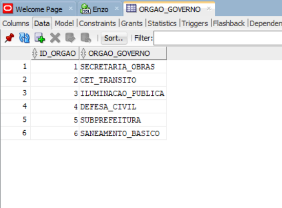
#### 4. Estrutura Territorial e Resolução de Localidades
* **Tabela `ENDERECO`:** Logradouros normalizados com CEP e ponto de referência:  
  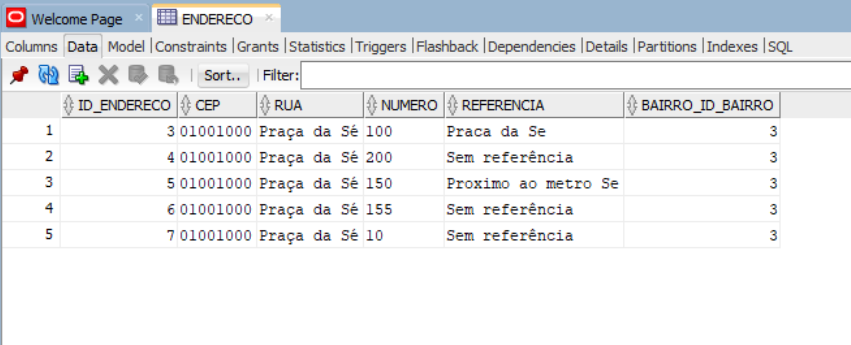
* **Tabela `BAIRRO`:** Bairros urbanos vinculados às cidades para fins estatísticos:  
  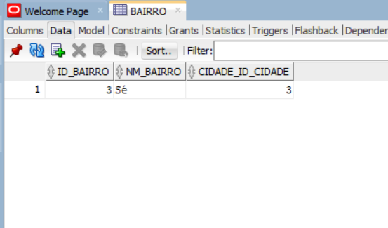
* **Tabela `CIDADE`:** Municípios federados:  
  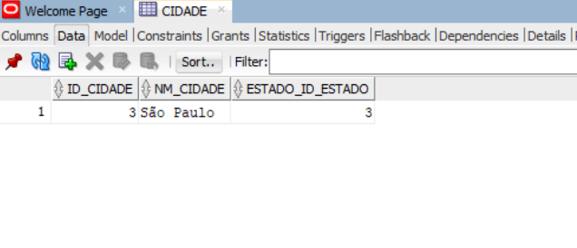
* **Tabela `ESTADO`:** Unidades Federativas do território nacional:  
  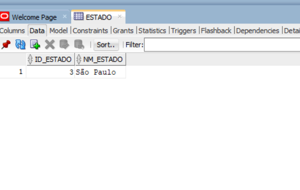

#### 5. Interface Interativa Swagger & Diagnósticos de Infraestrutura
* **Swagger OpenAPI UI:** Interface interativa na raiz do serviço (`/`):  
  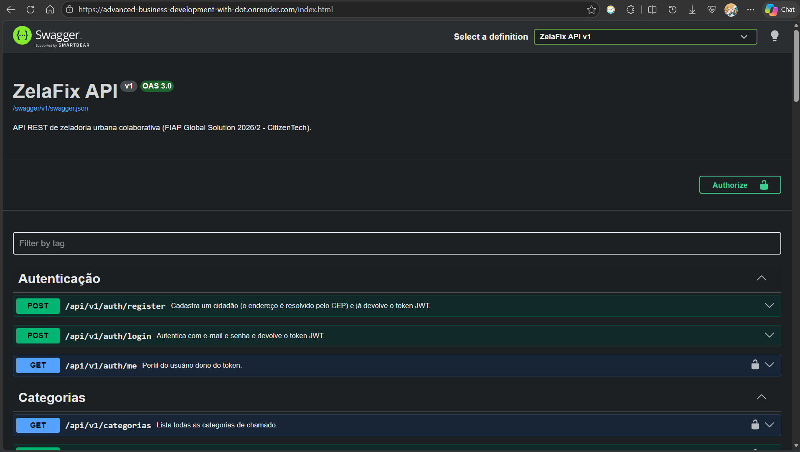
* **Health Checks Probe:** Resposta estruturada JSON de integridade e conectividade:  
  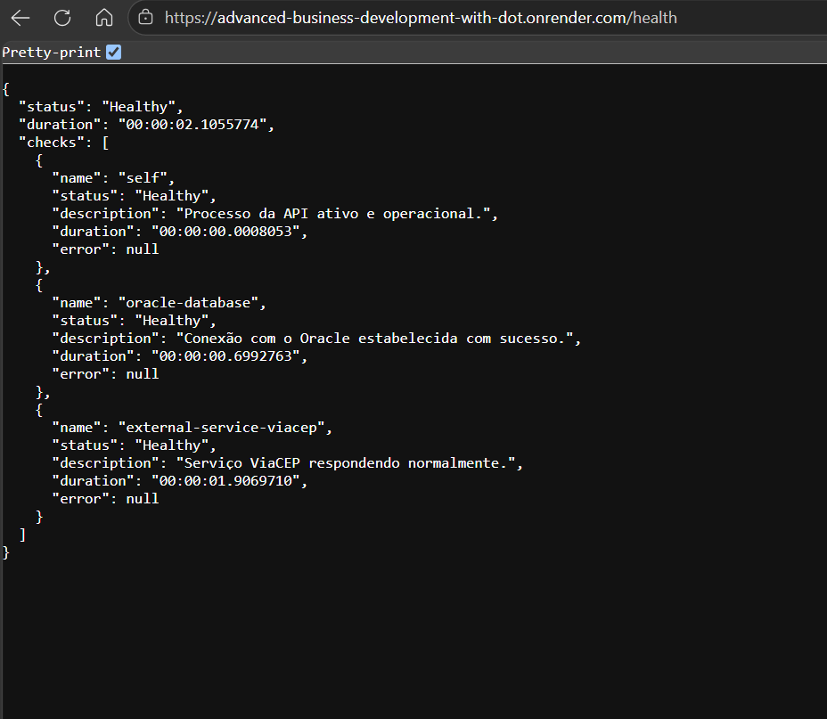

---

## 🏛️ Estrutura de Camadas da Solução (Clean Architecture & SOLID)

A organização física das pastas reflete o desacoplamento de responsabilidades do Domain-Driven Design:

```text
ZelaFix/
├── ZelaFix.Domain/                 # Camada de Domínio: POCOs puros, Entidades, Enums e Invariantes
│   ├── Common/                     # BaseEntity, PoliticaPrioridade, Validacao
│   ├── Entities/                   # 13 Entidades relacionais (Chamado, Categoria, Usuario, Endereco, etc.)
│   ├── Enums/                      # Cargo (Cidadao = 0, Gestor = 1) e extensões de mapeamento
│   ├── Exceptions/                 # DomainException (regras semânticas violadas)
│   └── Helpers/                    # HashHelper (Criptografia de senha com BCrypt)
│
├── ZelaFix.Application/            # Camada de Aplicação: Casos de Uso, DTOs (Records), Mappers e Contratos
│   ├── Auth/                       # JwtSettings, ClaimsNomes
│   ├── DTOs/                       # Records imutáveis com DataAnnotations (Requests, Responses, Filtros)
│   ├── Repositories/               # Contratos IChamadoRepository, IUsuarioRepository, ICategoriaRepository, IUnitOfWork
│   └── Services/                   # Interfaces e Implementações dos Serviços de Aplicação (Auth, Categoria, Chamado, ViaCEP)
│
├── ZelaFix.Infrastructure/         # Camada de Infraestrutura: EF Core Oracle
│   ├── Persistence/                # ZelaFixDbContext, DbInitializer, Migrations Oracle
│   │   ├── Configurations/         # Fluent API isolada (Cadastro, Chamado, Localizacao, Usuario)
│   │   └── Repositories/           # Implementações Repository<T>, ChamadoRepository, UsuarioRepository, UnitOfWork
│   └── DependencyInjection.cs      # Injeção de dependências (Oracle 19c SQL compatibility)
│
├── ZelaFix.Api/                    # Camada de Apresentação & Hosting: Minimal APIs, Segurança e Observabilidade
│   ├── Endpoints/                  # Mapeamento modularizado (Auth/Usuários, Categorias, Chamados)
│   ├── Exceptions/                 # GlobalExceptionHandler (RFC 7807 Problem Details)
│   ├── Extensions/                 # ServiceCollectionExtensions, RateLimitingExtensions, HealthExtensions
│   ├── Filters/                    # ValidationFilter (validação automática de DataAnnotations no pipeline)
│   ├── Health/                     # OracleDbHealthCheck, ViaCepHealthCheck, HealthResponseWriter, HealthChecksDocumentFilter
│   ├── Idempotency/                # IdempotencyFilter, MemoryIdempotencyStore (Header Idempotency-Key)
│   ├── Middleware/                 # CorrelationIdMiddleware (rastreabilidade distribuída X-Correlation-ID)
│   └── Security/                   # AuthorizationPolicies (GestorOnly), BearerSecurityOperationFilter
│
├── ZelaFix.Tests.Unit/             # Suíte de Testes Unitários xUnit (53 testes — Domínio e Aplicação com Moq)
│   ├── Application/                # AuthServiceTests, CategoriaServiceTests, ChamadoServiceTests, FotoImagemTests, TokenServiceTests, ViaCepAndRegisterTests
│   └── Domain/                     # EnderecoTests, StatusTests, UsuarioTests, DomainEntitiesTests
│
└── ZelaFix.Tests.Integration/      # Suíte de Testes de Integração (53 testes — WebApplicationFactory e InMemory DB)
    ├── Endpoints/                  # AuthIntegrationTests, CategoriaIntegrationTests, ChamadoIntegrationTests, InfraestruturaIntegrationTests, ObservabilityAndHateoasIntegrationTests, RepositoriesAndInfrastructureTests
    └── Fixtures/                   # CustomWebApplicationFactory, FakeViaCepService
```

---

## 📊 Monitoramento, Resiliência e Observabilidade Corporativa

A API conta com arquitetura de observabilidade em tempo real, pronta para ambientes conteinerizados e orquestradores (Docker Compose, Kubernetes, Azure Container Apps):

### 1. Health Checks Estruturados (`HealthCheckResponseWriter`)
Endpoints de diagnóstico serializados em JSON padronizado com tempos de resposta de cada dependência:

| Endpoint | Propósito | Componentes Verificados | Status Esperado |
| :--- | :--- | :--- | :---: |
| **`/health`** | Diagnóstico completo de integridade | Processo API + Conectividade Oracle (`CanConnectAsync`) + API Externa ViaCEP | `200 Healthy` |
| **`/health/ready`** | Readiness Probe (Prontidão para receber tráfego) | Conexão ativa com o banco Oracle Database e integridade do pool EF Core | `200 Healthy` |
| **`/health/live`** | Liveness Probe (Detecção de travamento de processo) | Thread pool ativa e servidor HTTP respondendo | `200 Healthy` |

**Exemplo de Resposta Estruturada (`GET /health`):**
```json
{
  "status": "Healthy",
  "duration": "00:00:02.1055774",
  "checks": [
    {
      "name": "self",
      "status": "Healthy",
      "description": "Processo da API ativo e operacional.",
      "duration": "00:00:00.0008053",
      "error": null
    },
    {
      "name": "oracle-database",
      "status": "Healthy",
      "description": "Conexão com o Oracle estabelecida com sucesso.",
      "duration": "00:00:00.6992763",
      "error": null
    },
    {
      "name": "external-service-viacep",
      "status": "Healthy",
      "description": "Serviço ViaCEP respondendo normalmente.",
      "duration": "00:00:01.9069710",
      "error": null
    }
  ]
}
```

### 2. Idempotência em Requisições Críticas (`IdempotencyFilter`)
Para garantir integridade de chamados e evitar múltiplas cobranças ou registros fantasmas por oscilação de 4G/5G móvel, a API intercepta requisições contendo o cabeçalho `Idempotency-Key`:
* Se a chave for inédita: a operação é executada, o resultado com código HTTP e corpo é armazenado no `MemoryIdempotencyStore`.
* Se a chave for repetida: a operação é curto-circuitada antes do serviço, retornando a resposta gravada acompanhada do cabeçalho HTTP:
  ```http
  Idempotent-Replayed: true
  ```

### 3. Rate Limiting Nativo por Janela Fixa (Fixed Window)
Configurado no startup da API via ASP.NET Core RateLimiter:
- **`GlobalPolicy`:** 100 requisições permitidas por janela de 60 segundos por IP.
- **`AuthPolicy`:** 10 requisições permitidas por janela de 60 segundos por IP para endpoints sensíveis de autenticação.
- Ao ultrapassar a cota, a API devolve automaticamente status `429 Too Many Requests` com o cabeçalho `Retry-After`.

### 4. Tratamento Global de Erros (RFC 7807 Problem Details)
Todas as exceções não tratadas e falhas de invariantes de negócio são capturadas pelo `GlobalExceptionHandler`, garantindo formato padronizado de erro (`application/problem+json`) com diagnósticos e `correlationId`:
```json
{
  "type": "about:blank",
  "title": "Acesso negado",
  "status": 403,
  "detail": "O autor não pode apoiar o próprio chamado.",
  "instance": "/api/v1/chamados/10/apoiar",
  "error": "Acesso negado",
  "message": "O autor não pode apoiar o próprio chamado.",
  "path": "/api/v1/chamados/10/apoiar",
  "timestamp": "2026-11-17T22:30:00.0000000Z",
  "traceId": "00-4bf92f3577b34da6a3ce929d0e0e4736-00f067aa0ba902b7-01",
  "correlationId": "0HNQ52K4T5JN9"
}
```

---

## 📱 Aplicativo Mobile Integrado (ZelaFix Mobile)

> O aplicativo mobile desenvolvido especialmente para consumir esta API está hospedado no repositório oficial:  
> 🔗 **[Global-Solution-CitizenTech / Mobile-Application-Development-Dot-Net](https://github.com/Global-Solution-CitizenTech/Mobile-Application-Development-Dot-Net)**

### ⚙️ Configuração de Conexão Mobile ➔ Backend .NET
Para conectar o app mobile React Native (Expo) à API .NET 10 em ambiente de desenvolvimento local:
* **Ambiente Web / Host Direto:** `http://localhost:5034/api/v1`
* **Emulador Android Oficial:** `http://10.0.2.2:5034/api/v1`
* **Dispositivo Físico via Expo Go:** `http://<IP_LOCAL_DA_MAQUINA>:5034/api/v1` (com porta 5034 liberada no firewall)

---

### 🌟 Ajustes e Otimizações de Integração Realizados
1. **Suporte a Miniaturas Fotográficas (`GET /api/v1/chamados?incluirFoto=true`):**
   - Na listagem de chamados (feed "Radar do Bairro"), `ChamadoFiltro.IncluirFoto` tem padrão `true` (e aceita `incluirFoto=false` para payloads enxutos).
   - Quando `true`, a API projeta os bytes da foto binária persistida em `BLOB` como string Base64 diretamente no campo `fotoBase64` do DTO `ChamadoResponse`, permitindo renderização imediata de miniaturas nos cards do app sem requisições HTTP adicionais.
2. **Trilha Histórica de Protocolo Reversa (`HIST_CHAMADO`):**
   - Na tela de detalhes da ocorrência, a trilha de andamento do protocolo cívico (`Historico`) é ordenada no repositório das movimentações mais recentes para as mais antigas, com `StatusAnterior` mapeado corretamente em [ChamadoMapper.cs](ZelaFix/ZelaFix.Application/Services/ChamadoMapper.cs).
3. **Estabilidade de Renderização em Listas (React Native `FlatList`):**
   - Chaves compostas normalizadas para evitar conflitos de reconciliação virtual (`keyExtractor`), eliminando warnings de elementos duplicados.
4. **Indicadores e Estatísticas Municipais:**
   - Consumo integrado do endpoint `GET /api/v1/chamados/estatisticas` (e rota direta `GET /chamados/estatisticas`) para alimentação dos cards e taxa de resolução na Home do app mobile.
5. **Autenticação Segura JWT e Compatibilidade de Rotas Diretas:**
   - Exposição transparente de rotas diretas (`/login`, `/usuarios`, `/usuarios/me`, `/categorias/*`, `/chamados/*`) além do prefixo `/api/v1/*`, aceitando tanto payloads planos quanto objetos aninhados (`RegisterEnderecoInput`, `ddd`+`numeroTelefone`) e retornando `AuthResponse` com `usuario` e `user`.
6. **Proteção Contra Duplicidade com `Idempotency-Key` e Toggle de Apoio:**
   - O aplicativo móvel gera UUIDs no cabeçalho HTTP `Idempotency-Key` em `POST /chamados` e `PATCH /chamados/{id}/status`, alterna apoio via `POST` / `DELETE /chamados/{id}/apoiar` conforme o estado atual e envia os campos completos exigidos em `PUT /chamados/{id}`.
7. **Tratamento Amigável de Erros (RFC 7807 Problem Details):**
   - A API devolve objetos padronizados de erro com campo `detail` (`message`) e lista `erros` (`[{ campo, mensagem }]`), consumidos diretamente pelo app para exibição de mensagens claras aos munícipes.

--- 

## 📋 Catálogo Completo de Endpoints REST (23 Paths no Swagger)

A API expõe **23 paths** e **34 operações** organizadas em **7 grupos** documentados interativamente via Swagger OpenAPI 3.0 na raiz (`/`): `Autenticação`, `Usuários`, `Categorias`, `Categorias (Rotas Diretas)`, `Chamados`, `Chamados (Rotas Diretas)` e `Monitoramento & Health`.

---

### 🔐 1. Autenticação (`/api/v1/auth`) & Usuários (`/login`, `/usuarios`)
*Emissão, validação de tokens JWT (RFC 7519 / HS256) e perfil contextual do usuário.*

| Método | Endpoint | Perfil / Autorização | Cabeçalhos Especiais | Descrição | Status Codes |
| :---: | :--- | :---: | :---: | :--- | :---: |
| `POST` | `/api/v1/auth/register` | `[AllowAnonymous]` | Rate Limit (Auth) | Cadastra novo cidadão (resolve endereço via CEP) e emite token JWT | `201`, `400`, `409`, `429` |
| `POST` | `/api/v1/auth/login` | `[AllowAnonymous]` | Rate Limit (Auth) | Autentica munícipe ou gestor por e-mail e senha, emitindo token JWT | `200`, `400`, `401`, `429` |
| `GET` | `/api/v1/auth/me` | `[Authorize]` | `Authorization: Bearer <token>` | Retorna os dados cadastrais e perfil do usuário dono do token | `200`, `401`, `404` |
| `POST` | `/usuarios` | `[AllowAnonymous]` | Rate Limit (Auth) | Rota direta de cadastro de cidadão (compatibilidade Swagger/Mobile) | `201`, `400`, `409`, `429` |
| `POST` | `/login` | `[AllowAnonymous]` | Rate Limit (Auth) | Rota direta de autenticação JWT (compatibilidade Swagger/Mobile) | `200`, `400`, `401`, `429` |
| `GET` | `/usuarios/me` | `[Authorize]` | `Authorization: Bearer <token>` | Rota direta de consulta do perfil autenticado | `200`, `401`, `404` |
| `PUT` | `/usuarios/me` | `[Authorize]` | `Authorization: Bearer <token>` | Consulta/sincronização do perfil autenticado (compatibilidade Mobile) | `200`, `401`, `404` |

---

### 🏷️ 2. Categorias de Zeladoria (`/api/v1/categorias`)
*Catálogo oficial de tipologias de serviços municipais.*

| Método | Endpoint | Perfil / Autorização | Cabeçalhos Especiais | Descrição | Status Codes |
| :---: | :--- | :---: | :---: | :--- | :---: |
| `GET` | `/api/v1/categorias` | `[Authorize]` | `Authorization: Bearer <token>` | Lista todas as categorias de zeladoria urbana ativas | `200`, `401` |
| `GET` | `/api/v1/categorias/{id}` | `[Authorize]` | `Authorization: Bearer <token>` | Obtém os dados detalhados de uma categoria específica por ID | `200`, `401`, `404` |
| `POST` | `/api/v1/categorias` | `GestorOnly` | `Authorization: Bearer <token>` | Cadastra nova categoria de serviço público municipal | `201`, `400`, `401`, `403`, `409` |
| `PUT` | `/api/v1/categorias/{id}` | `GestorOnly` | `Authorization: Bearer <token>` | Atualiza a nomenclatura de uma categoria existente | `200`, `400`, `401`, `403`, `404`, `409` |
| `DELETE` | `/api/v1/categorias/{id}` | `GestorOnly` | `Authorization: Bearer <token>` | Remove uma categoria (retorna 409 se houver chamados vinculados) | `204`, `401`, `403`, `404`, `409` |

---

### 🛠️ 3. Chamados Urbanos de Zeladoria (`/api/v1/chamados`)
*Ciclo de vida completo das ocorrências municipais, foto em BLOB, paginação e engajamento.*

| Método | Endpoint | Perfil / Autorização | Cabeçalhos Especiais | Descrição | Status Codes |
| :---: | :--- | :---: | :---: | :--- | :---: |
| `GET` | `/api/v1/chamados` | `[Authorize]` | `Authorization: Bearer <token>` | Lista chamados paginados (página base 0) com filtros (`categoriaId`, `bairroId`, `status`, `busca`, `apenasMeus`, `incluirFoto`) | `200`, `401` |
| `GET` | `/api/v1/chamados/estatisticas` | `[Authorize]` | `Authorization: Bearer <token>` | Retorna métricas consolidadas (Total, Abertos, Em Andamento, Concluídos, Rejeitados, Apoios) | `200`, `401` |
| `GET` | `/api/v1/chamados/{id}` | `[Authorize]` | `Authorization: Bearer <token>` | Detalha a ocorrência completa com histórico de status e foto em Base64 | `200`, `401`, `404` |
| `POST` | `/api/v1/chamados` | `[Authorize]` | `Idempotency-Key` *(obrigatório)* | Registra novo chamado com foto, categoria e endereço resolvido | `201`, `400`, `401` |
| `PUT` | `/api/v1/chamados/{id}` | Autor / `GestorOnly` | `Authorization: Bearer <token>` | Edita ocorrência (autor apenas enquanto status for `PENDENTE`) | `200`, `400`, `401`, `403`, `404` |
| `PATCH` | `/api/v1/chamados/{id}/status` | `GestorOnly` | `Idempotency-Key` *(obrigatório)* | Movimenta status do chamado com parecer técnico e histórico imutável | `200`, `400`, `401`, `403`, `404` |
| `POST` | `/api/v1/chamados/{id}/apoiar` | `[Authorize]` | `Authorization: Bearer <token>` | Registra apoio popular (EF Core `VOTO_CHAMADO`); recalcula prioridade | `200`, `400`, `401`, `403`, `404`, `409` |
| `DELETE` | `/api/v1/chamados/{id}/apoiar` | `[Authorize]` | `Authorization: Bearer <token>` | Cancela apoio comunitário previamente concedido pelo munícipe | `200`, `401`, `404` |
| `DELETE` | `/api/v1/chamados/{id}` | Autor / `GestorOnly` | `Authorization: Bearer <token>` | Exclui ocorrência (autor apenas enquanto estiver `PENDENTE`) | `204`, `400`, `401`, `403`, `404` |

---

### 🩺 4. Monitoramento & Health Checks (`/health`)
*Sondas de integridade da API, Oracle Database e serviço externo ViaCEP expostas no Swagger.*

| Método | Endpoint | Perfil / Autorização | Cabeçalhos Especiais | Descrição | Status Codes |
| :---: | :--- | :---: | :---: | :--- | :---: |
| `GET` | `/health` | `[AllowAnonymous]` | — | Diagnóstico completo (Processo API + Oracle + ViaCEP) | `200`, `503` |
| `GET` | `/health/ready` | `[AllowAnonymous]` | — | Readiness Probe (Conectividade Oracle Database e ViaCEP) | `200`, `503` |
| `GET` | `/health/live` | `[AllowAnonymous]` | — | Liveness Probe (Processo ASP.NET Core ativo) | `200` |

> **Compatibilidade Mobile (Rotas Diretas):** Para atender clientes móveis sem prefixo `/api/v1`, a API também expõe no Swagger as rotas `/login`, `/usuarios`, `/usuarios/me`, `/categorias/*` e `/chamados/*`.

---

## 🧪 Suíte de Testes Automatizados (Padrão AAA & xUnit)

A solução conta com uma bateria rigorosa de testes automatizados seguindo o padrão **Arrange-Act-Assert (AAA)**, cobrindo regras de negócio, invariantes de domínio, isolamento com mocks e testes de integração de ponta a ponta:

```text
Suíte de Testes ZelaFix:
├── ZelaFix.Tests.Unit:        53 testes passando (100% sucesso)
└── ZelaFix.Tests.Integration: 53 testes passando (100% sucesso)
────────────────────────────────────────────────────────────────
Total Geral:                  106 Testes Passando com Sucesso! (0 Falhas)
```

### Cobertura de Código (Code Coverage - Cobertura XML)

| Camada / Assembly | Cobertura de Linhas (Line Rate) | Cobertura de Branches (Branch Rate) | Status de Qualidade |
| :--- | :---: | :---: | :--- |
| **`ZelaFix.Domain`** | **98.11%** | **86.76%** | 🟢 Excelente (Entidades ricas, Invariantes, Validações) |
| **`ZelaFix.Api`** | **95.28%** | **72.86%** | 🟢 Excelente (Endpoints, Filtros, Middlewares, RFC 7807) |
| **`ZelaFix.Application`** | **94.20%** | **72.50%** | 🟢 Excelente (Casos de uso, DTOs, Mappers, ViaCEP, Mídia) |
| **`ZelaFix.Infrastructure`** | **91.73%** | **52.00%** | 🟢 Alta (Repositórios, UnitOfWork, Fluent API EF Core)* |

> *Nota: Na camada `ZelaFix.Infrastructure`, classes auto-geradas de scaffolding DDL em `Persistence/Migrations` possuem `[ExcludeFromCodeCoverage]` para aferição real do código de repositórios, configurações e inicialização.*

### Detalhamento das Coberturas:
* **Testes Unitários de Domínio (`ZelaFix.Tests.Unit/Domain`):**
  - `EnderecoTests`: validação de CEP com regex, obrigatoriedade de campos e montagem de endereço formatado.
  - `StatusTests`: garantia das transições permitidas na máquina de estados e rejeição de transições inválidas.
  - `UsuarioTests`: validação de hashing de senha com BCrypt, formato de e-mail e papéis (`Cargo`).
  - `DomainEntitiesTests`: invariantes de `Chamado` (`AtualizarPrioridade`, `Apoiar`, bloqueio de duplicidade e validação de IDs), `Prioridade`, `OrgaoGoverno`, `Telefone` e `HashHelper`.
* **Testes Unitários de Aplicação (`ZelaFix.Tests.Unit/Application`):**
  - `AuthServiceTests`: registro de novos munícipes, verificação de duplicidade de e-mail, login e emissão de tokens.
  - `CategoriaServiceTests`: regras de CRUD, impedimento de exclusão de categoria com vínculos operacionais.
  - `ChamadoServiceTests`: abertura com endereço via mock do ViaCEP, autorização de edição/exclusão, registro de voto de apoio e escalonamento comunitário.
  - `FotoImagemTests`: validação de mime types permitidos (JPEG, PNG, WebP) e sanitização de Base64.
  - `TokenServiceTests`: integridade e tempo de expiração das claims geradas no token JWT.
  - `ViaCepAndRegisterTests`: integração HTTP de `ViaCepService` (sucesso, `erro: true`, `400 BadRequest`), compatibilidade de payload mobile em `RegisterRequest`, casos de borda em `FotoImagem` e `JwtSettings`.
* **Testes de Integração HTTP (`ZelaFix.Tests.Integration`):**
  - `CustomWebApplicationFactory`: pipeline web completo com banco de dados em memória e injeção de fakes controlados (`FakeViaCepService`).
  - `AuthIntegrationTests`: fluxos ponta a ponta de `/register`, `/login` e `/me`.
  - `CategoriaIntegrationTests`: proteção RBAC (`GestorOnly` retornando 403 Forbidden para cidadão comum).
  - `ChamadoIntegrationTests`: fluxo completo de abertura, paginação, filtros (`incluirFoto=false`), idempotência com cabeçalho `Idempotency-Key` e tramitação de status com histórico reverso.
  - `ObservabilityAndHateoasIntegrationTests`: validação de propagação de `X-Correlation-ID`, formato RFC 7807 Problem Details e links hipermídia HATEOAS (`_links`).
  - `InfraestruturaIntegrationTests`: respostas dos health checks e validação de rate limiting com cabeçalho `Retry-After`.
  - `RepositoriesAndInfrastructureTests`: cobertura direta de `Repository<T>`, `ChamadoRepository` (`MaisApoiados`, `BairroId`, `GetFotoAsync`), `UnitOfWork`, `DbInitializer`, `MemoryIdempotencyStore` e todos os mapeamentos de exceção do `GlobalExceptionHandler`.

---

## 🚀 Ambiente em Produção (Render) & Execução Local

### 🌐 Acesso Direto em Produção (Render Cloud)
* **URL Base / Swagger UI:** https://advanced-business-development-with-dot.onrender.com/
* **OpenAPI JSON:** https://advanced-business-development-with-dot.onrender.com/swagger/v1/swagger.json
* **Health Check Geral:** https://advanced-business-development-with-dot.onrender.com/health

> **Nota de Infraestrutura:** O deploy em nuvem no Render utiliza o `Dockerfile` multi-stage da raiz e exige que a variável de ambiente `ConnectionStrings__ZelaFixOracle` aponte para uma instância Oracle acessível externamente (ex.: `oracle.fiap.com.br:1521/ORCL`).

---

## 💻 Como Executar a Aplicação Localmente

### 1. Pré-requisitos
* [.NET 10 SDK](https://dotnet.microsoft.com/) instalado.
* [Docker Desktop](https://www.docker.com/) ativo no sistema operacional.

---

### Opção A: Execução via Docker & Oracle FreePDB1 Local (Recomendado)

1. **Subir o Container do Banco de Dados Oracle:**
   Execute no terminal para inicializar a instância oficial leve do Oracle Database Express:
   ```bash
   docker run -d --name oracle-zelafix -p 1521:1521 -e ORACLE_PASSWORD=oracle -e APP_USER=zelafix -e APP_USER_PASSWORD=zelafix gvenzl/oracle-free:slim
   ```

2. **Executar a API ZelaFix:**
   No diretório da solução, execute diretamente via .NET CLI (o EF Core cria/gerencia as tabelas relacionais automaticamente):
   ```powershell
   cd Advanced-Business-Development-with-Dot-Net\ZelaFix\ZelaFix.Api
   dotnet run
   ```

3. **Acessar a Documentação Interativa:**
   Abra no seu navegador:
   * **Swagger UI:** `http://localhost:5034/` (ou `http://localhost:5289/` dependendo da porta alocada)
   * **Health Check Geral:** `http://localhost:5034/health`

---

### Opção B: Execução com Banco de Dados Nuvem FIAP (Oracle 19c)

Caso prefira conectar na infraestrutura acadêmica remota da FIAP, configure o arquivo `.env` (baseado em `.env.example`):
```env
ConnectionStrings__ZelaFixOracle=User Id=seu_rm;Password=sua_senha;Data Source=oracle.fiap.com.br:1521/ORCL;
Jwt__Key=zelafix-super-secret-jwt-token-key-2026-min-32-chars-long!
```
E inicie o projeto normalmente via `dotnet run`.

---

### Credenciais de Usuários de Teste (Seed Automático via `DbInitializer`)
Na inicialização da API sobre o Oracle Database, o `DbInitializer` garante automaticamente a existência de duas contas de teste prontas para validação dos perfis RBAC no Swagger (`POST /api/v1/auth/login`) e no arquivo `ZelaFix.http`:

| Perfil / Role (`Cargo`) | E-mail | Senha | Permissões no Ecossistema |
| :--- | :--- | :--- | :--- |
| **`CIDADAO`** | `cidadao@zelafix.com.br` | `Password123!` | Abrir chamados com foto, editar/excluir próprios chamados pendentes, apoiar chamados de vizinhos e consultar estatísticas. |
| **`GESTOR`** | `gestor@zelafix.com.br` | `Password123!` | Todas as permissões de consulta + política `GestorOnly` (tramitar status em `PATCH /chamados/{id}/status`, gerenciar categorias em `POST/PUT/DELETE /categorias` e moderar chamados). |

---

### Executando a Bateria Completa de Testes
Para rodar toda a suíte de testes automatizados:
```powershell
dotnet test Advanced-Business-Development-with-Dot-Net\ZelaFix\ZelaFix.sln
```

---

## 📌 Backlog Estruturado do Projeto ZelaFix (Azure Boards)

O roadmap técnico e funcional do backend .NET ZelaFix é governado no **Azure Boards** sob o processo Scrum, estruturado em **1 Epic**, **5 Features** e **15 Product Backlog Items (PBIs)**:

```text
[EPIC] Advanced Business Development with .NET: API RESTful ZelaFix em .NET 10, EF Core Oracle, Resiliência e Integração Mobile [AB#27]
│
├── 🏆 [FEATURE 01] Arquitetura Limpa, Domínio Relacional e Persistência Oracle com EF Core [AB#28]
│   ├── 📄 [PBI-01] Setup da Solução .NET 10, Clean Architecture e Injeção de Dependências [AB#29]
│   ├── 📄 [PBI-02] Modelagem de Entidades Relacionais 3FN e Mapeamentos Fluent API no EF Core [AB#30]
│   └── 📄 [PBI-03] Repositórios Especializados, Unit of Work e Persistência de Fotos em BLOB [AB#200]
│
├── 🏆 [FEATURE 02] Serviços de Aplicação, Integrações Externas e Regras Cívicas [AB#31]
│   ├── 📄 [PBI-04] Resolução Resiliente de Endereços Urbanos via HttpClient e API Externa ViaCEP [AB#32]
│   ├── 📄 [PBI-05] Mobilização Popular, Votação Comunitária e Escalonamento Automático de Prioridade [AB#33]
│   └── 📄 [PBI-06] Trilha de Auditoria Histórica (HIST_CHAMADO) e Transição de Status Operacional [AB#201]
│
├── 🏆 [FEATURE 03] Minimal APIs RESTful, Segurança JWT e Resiliência HTTP [AB#34]
│   ├── 📄 [PBI-07] Autenticação JWT Bearer HS256, Criptografia BCrypt e Controle de Acesso RBAC [AB#35]
│   ├── 📄 [PBI-08] Endpoints de Ocorrências com Filtros Dinâmicos, Paginação e Miniaturas (incluirFoto) [AB#202]
│   └── 📄 [PBI-09] Idempotência de Requisições com Header Idempotency-Key e Rate Limiting Nativo [AB#203]
│
├── 🏆 [FEATURE 04] Observabilidade Corporativa e Integração com Ecossistema Mobile [AB#204]
│   ├── 📄 [PBI-10] Observabilidade com Health Checks Integrados ao Oracle e Logging Estruturado Serilog [AB#205]
│   ├── 📄 [PBI-11] Integração Full-Stack com App Mobile React Native e Compatibilização de Rotas [AB#206]
│   └── 📄 [PBI-12] Estatísticas Consolidadas de Chamados e Filtros Territoriais no Radar [AB#207]
│
└── 🏆 [FEATURE 05] Qualidade de Software, Testes Automatizados e Governança [AB#208]
    ├── 📄 [PBI-13] Suíte de Testes Unitários de Domínio e Aplicação com xUnit no Padrão AAA e Moq [AB#209]
    ├── 📄 [PBI-14] Testes de Integração com WebApplicationFactory, Banco em Memória e Contratos HTTP [AB#210]
    └── 📄 [PBI-15] Documentação OpenAPI/Swagger 3.0, Diagramas de Arquitetura e README Técnico [AB#211]
```

### 📊 Tabela Consolidada de PBIs e Rastreabilidade

| Feature Pai | ID PBI | Título do Item de Backlog | Story Points | Prioridade | Commits Vinculados | Status |
| :--- | :--- | :--- | :---: | :---: | :--- | :---: |
| **Feature 01** `[#28]` | **PBI-01** `[#29]` | Setup da Solução .NET 10, Clean Architecture e DI | 3 pts | 1 - Critical | `f80ba46`, `d0732c8` | Committed |
| | **PBI-02** `[#30]` | Modelagem Relacional 3FN e Mapeamentos Fluent API | 3 pts | 1 - Critical | `d0732c8`, `ea8bdd4` | Committed |
| | **PBI-03** `[#200]` | Repositórios, Unit of Work e Fotos em BLOB | 3 pts | 1 - Critical | `39a4f79` | Committed |
| **Feature 02** `[#31]` | **PBI-04** `[#32]` | Resolução de Endereços com HttpClient e ViaCEP | 3 pts | 1 - Critical | `048bef7` | Committed |
| | **PBI-05** `[#33]` | Apoio Comunitário e Escalonamento de Prioridade | 3 pts | 1 - Critical | `048bef7`, `e3e244c` | Committed |
| | **PBI-06** `[#201]` | Trilha Histórica (HIST_CHAMADO) e Transição Status | 3 pts | 1 - Critical | `048bef7`, `4d279f4` | Committed |
| **Feature 03** `[#34]` | **PBI-07** `[#35]` | Autenticação JWT HS256, BCrypt e RBAC | 3 pts | 1 - Critical | `894b532` | Committed |
| | **PBI-08** `[#202]` | Endpoints Ocorrências, Paginação e Miniaturas Foto | 3 pts | 1 - Critical | `894b532`, `ee3696b` | Committed |
| | **PBI-09** `[#203]` | Idempotency-Key e Rate Limiting Nativo | 3 pts | 1 - Critical | `894b532` | Committed |
| **Feature 04** `[#204]` | **PBI-10** `[#205]` | Observabilidade, Health Checks Oracle e Serilog | 3 pts | 1 - Critical | `894b532`, `cd487c4` | Committed |
| | **PBI-11** `[#206]` | Integração Full-Stack com App Mobile React Native | 3 pts | 1 - Critical | `894b532`, `ee3696b` | Committed |
| | **PBI-12** `[#207]` | Estatísticas Consolidadas e Filtros Territoriais | 3 pts | 1 - Critical | `894b532`, `f5a8305` | Committed |
| **Feature 05** `[#208]` | **PBI-13** `[#209]` | Testes Unitários com xUnit no Padrão AAA e Moq | 3 pts | 1 - Critical | `e5f9a26`, `49be863` | Committed |
| | **PBI-14** `[#210]` | Testes de Integração com WebApplicationFactory | 3 pts | 1 - Critical | `53dd111` | Committed |
| | **PBI-15** `[#211]` | Documentação Técnica, Swagger OpenAPI e README | 3 pts | 1 - Critical | `ee3696b`, `cd487c4` | Committed |
| **TOTAL** | **5 Features** | **15 PBIs** | **45 pts** | — | **8 Commits Principais** | **100% Concluído** |

---

## 🤖 Declaração de Uso de Inteligência Artificial Generativa

Em conformidade com as diretrizes institucionais da **FIAP Global Solution 2026/2 (Seção 1.11 — Política de Uso de Inteligência Artificial Generativa)**, declaramos de forma transparente as ferramentas de IA Generativa utilizadas como apoio no desenvolvimento deste repositório e suas respectivas finalidades:

| Ferramenta de IA | Finalidade Específica no Projeto | Revisão e Validação Humana |
| :--- | :--- | :--- |
| **GitHub Copilot / Claude / Gemini** | Apoio na geração de cenários de testes unitários e de integração (padrão AAA com xUnit e Moq), sugestão de expressões regulares e revisão da documentação OpenAPI/Swagger e diagramas ASCII no `README.md`. | Todos os códigos, mapeamentos EF Core Oracle, políticas de segurança JWT/RBAC, filtros de idempotência e testes foram integralmente revisados, executados e validados tecnicamente pelos integrantes do grupo. |

> **Nota sobre Uso de IA no Runtime da API .NET:** A aplicação **ZelaFix API (.NET 10)** não consome APIs externas de LLMs em tempo de execução, mantendo foco estrito nos requisitos da disciplina de *Advanced Business Development with .NET* (Minimal APIs RESTful, EF Core Oracle, JWT, Idempotência, Rate Limiting, Health Checks e Testes xUnit).
